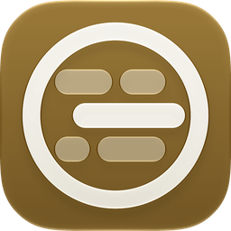

<p align="center"></p>

# tskdeck

A desktop client for the [tsk](https://gettsk.sh/) task board.

tskdeck is not affiliated with `smarzban/tsk`.

tskdeck shows the board next to an always-visible sidebar of views, projects, threads and assignees, so any scope is one click or keypress away. All writes go through the `tsk` CLI, and the board stays in sync with the terminal board and with agents writing to the same store.

## Requirements

- [tsk 0.13.0 or later](https://gettsk.sh/docs/install/)

tskdeck finds `tsk` from the path set in settings, then the login shell's `PATH`, then the default install locations. It respects `TSK_STATE_DIR`.

## What works

- Sidebar with Views (Desk, All projects), Projects, Threads and Assignees, each with a live task count.
- Project names: right-click a project in the sidebar and choose Rename… to give it a name tskdeck shows wherever the project appears. tsk keeps the project's path.
- Board with the NEEDS YOU, IN MOTION and ON DECK sections, plus group and sort controls.
- Task view beside the board or as an overlay: title and notes edited in place, status, assignee and "runs after", steps, activity, and Done, Reply and Archive actions.
- The blocked and review workflow: block and review cards, options, replies, approve and send back, and changing who a task waits on. Review checks are shown read-only.
- Quick capture of new tasks inside the app window.
- Search, multi-select with bulk actions, and undo for changes made in tskdeck.
- The done drawer with archived tasks and unarchive.
- A command palette (`⌘K` / `Ctrl+K`) and a rebindable keymap that defaults to the terminal board's keys. `Ctrl` chords stay `Ctrl` on every platform; on macOS `⌘` is used for app keys only.
- Light and dark themes that follow the system.

## Not supported yet

- Moving tasks between threads or projects.
- Deleting tasks.
- Marking review checks passed or failed.
- A system-wide capture shortcut; capture works inside the tskdeck window.
- Archiving projects, folding groups, and hiding agent live lines.
- Running inside Herdr UI.

## Install

Download the installer for your platform from the [Releases](https://github.com/s3rgiosan/tskdeck/releases) page.

- macOS: the `.dmg` for Apple silicon (`aarch64`) or Intel (`x64`).
- Linux: the `.AppImage` or `.deb`.
- Windows: the `.msi`.

Releases are not notarized or code-signed by a publisher. The macOS app has an ad-hoc signature only.

### Updates

tskdeck looks for a newer release one minute after launch, and then once a day. When it finds one, a card at the foot of the sidebar shows **Install and Relaunch** and **Later**. To check at once, choose **Check for Updates…** in the app menu on macOS, or in the command palette. To stop the automatic checks, clear **Check for updates automatically** in Settings → General.

### Opening the app on macOS

The macOS build is ad-hoc signed and not notarized, so macOS says that it is damaged on first launch. Move `tskdeck.app` to `/Applications`, then remove the quarantine flag:

```sh
xattr -dr com.apple.quarantine /Applications/tskdeck.app
```

## Settings

tskdeck keeps its settings (open-task mode, keymap, path to `tsk`, update checks) in `settings.json` inside the app config directory for the identifier `com.s3rgiosan.tskdeck`:

- macOS: `~/Library/Application Support/com.s3rgiosan.tskdeck/settings.json`
- Linux: `$XDG_CONFIG_HOME/com.s3rgiosan.tskdeck/settings.json`, or `~/.config/com.s3rgiosan.tskdeck/settings.json` when `XDG_CONFIG_HOME` is unset
- Windows: `%APPDATA%\com.s3rgiosan.tskdeck\settings.json`

tsk's own `config.toml` is never touched.

## Development

```sh
npm ci
npm run tauri dev
```

Run the app against a throwaway board so development never writes to your real one:

```sh
TSK_STATE_DIR=$(mktemp -d) npm run tauri dev
```

Checks:

```sh
npm run typecheck
npm test
cargo test --manifest-path src-tauri/Cargo.toml
```

The contract test runs the real `tsk` binary against a temporary store. It needs tsk 0.13.0 on `PATH`:

```sh
cargo test --manifest-path src-tauri/Cargo.toml --test contract -- --ignored
```

The app icon's source is the Icon Composer document `src-tauri/icons/AppIcon.icon`. After changing it, rebuild `Assets.car` and the fallback `.icns`, `.ico` and PNG files, then commit them. This needs Xcode 26 or later:

```sh
sh scripts/build-app-icon.sh
```

## Licence

[MIT](LICENSE)
